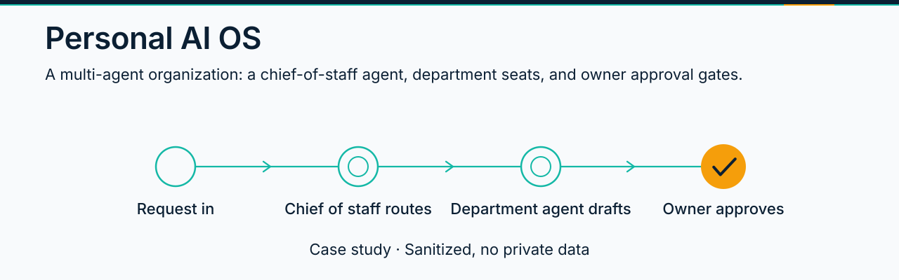
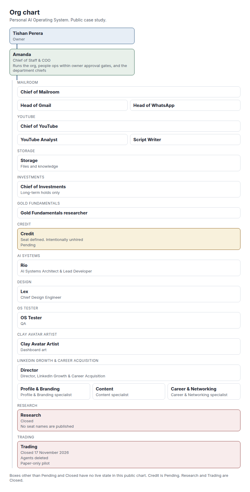
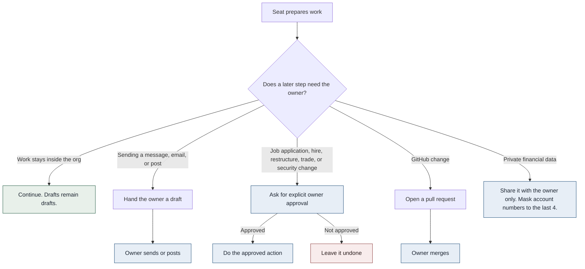
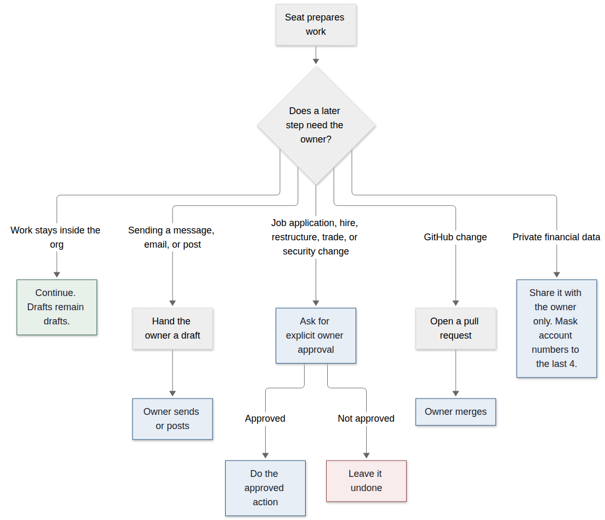
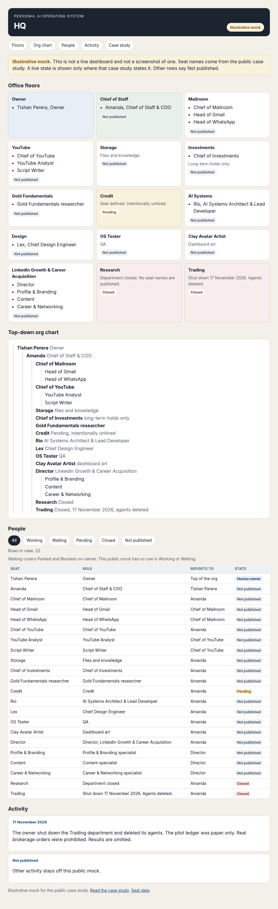

# Tishan Perera — Personal AI Operating System

A public case study of a personal multi-agent organization: chief of staff Amanda, department seats, and owner approval before a message is sent, a job is applied for, a hire is made, or a trade is placed.

For finance ops, FP&A, and AI automation roles.

## 30-second summary

I am Tishan Perera. I am looking at finance ops, FP&A, and AI automation roles. This repo is how I run a personal multi-agent organization. Internally I call it the Grokbot organization. In public it is my Personal AI Operating System.

I am the only owner. Amanda, Chief of Staff & COO, runs the org, people ops within my approval gates, and the department chiefs. Seats cover mail, YouTube, storage, long-term investments, gold research, an unhired Credit seat, AI systems, design, QA, dashboard art, and LinkedIn career work. Research is closed. A paper-only Trading pilot was shut down on 17 November 2026, and its agents were deleted.

Agents draft outbound messages. I send them. Hiring, posting, job applications, trading, security changes, and GitHub merges stay with me. Private financial data stays with me. Account numbers are masked to the last 4.

On weekday mornings Amanda gives me an executive brief: org status counts, priorities, decisions needed, the usage limit, and tomorrow's calendar.

The runnable demo called Atrium is a fictional clone in a separate repo.

## Org chart

Every box reports upward as drawn. Live state is published only for Credit (Pending, intentionally unhired), Research (Closed), and Trading (Closed). Other seats are real. Their live state is omitted here.

```mermaid
flowchart TB
  owner["Tishan Perera<br/>Owner"] --> amanda["Amanda<br/>Chief of Staff and COO"]
  amanda --> mail["Chief of Mailroom"]
  mail --> gmail["Head of Gmail"]
  mail --> wa["Head of WhatsApp"]
  amanda --> yt["Chief of YouTube"]
  yt --> yta["YouTube Analyst"]
  yt --> scriptw["Script Writer"]
  amanda --> storage["Storage<br/>files and knowledge"]
  amanda --> invest["Chief of Investments<br/>long-term holds only"]
  amanda --> gold["Gold Fundamentals researcher"]
  amanda --> credit["Credit<br/>Pending, intentionally unhired"]
  amanda --> rio["Rio<br/>AI Systems Architect and Lead Developer"]
  amanda --> lex["Lex<br/>Chief Design Engineer"]
  amanda --> qa["OS Tester<br/>QA"]
  amanda --> clay["Clay Avatar Artist<br/>dashboard art"]
  amanda --> director["Director<br/>LinkedIn Growth and Career Acquisition"]
  director --> brand["Profile and Branding"]
  director --> contentSeat["Content"]
  director --> network["Career and Networking"]
  amanda --> research["Research<br/>Closed"]
  amanda --> trading["Trading<br/>Closed 17 November 2026<br/>agents deleted"]
  classDef closed fill:#f8ecec,stroke:#8d3d3d,color:#2b1d1d
  classDef pending fill:#f8f1dc,stroke:#8a5a12,color:#2b2416
  classDef human fill:#e7eef6,stroke:#1f4e79,color:#1c2430
  classDef lead fill:#e8f0ea,stroke:#245c45,color:#1c2430
  class owner human
  class amanda lead
  class research,trading closed
  class credit pending
```

The figure is the same chart, stacked so the names stay readable. Seat list, reporting lines, and states: [docs/org-chart.md](docs/org-chart.md). Machine-readable copy: [data/org.json](data/org.json).

## Request and approval flow

Matrix and the same flow in prose: [docs/approval-gates.md](docs/approval-gates.md).

## What this shows about how I work

- **Judgment.** Credit is a defined seat, and it is unhired. Research is closed. Trading was shut down on 17 November 2026 and the agents were deleted.
- **Controls.** Outbound work stays a draft until I send it. Posts, job applications, hires, restructuring, trades, and security changes need my approval. GitHub changes land through pull requests I merge. Private financial data stays with me. Account numbers are masked to the last 4.
- **Cost discipline.** Each chief has a weekly KPI. The morning brief includes the usage limit. Dashboard polish waits for a business KPI and a usage check.
- **Killing experiments.** The Trading pilot used a simulated ledger and a hard rule of no real brokerage orders. Live trading required explicit authorization. When the pilot was not going to continue, I closed the department and removed the agents.

## HQ

The org has an HQ page: office floors per department, a top-down org chart, a people list with filters, and an activity timeline.

**Illustrative mock.** Built from the public seat list above. It is not a screenshot of the live HQ.

Open the page: [docs/hq-mock/index.html](docs/hq-mock/index.html).

## Related public repos

- [personal-ai-os-demo](https://github.com/tishan-perera/personal-ai-os-demo) — fictional runnable clone called Atrium. Separate from this organization.
- [close-recon-assistant](https://github.com/tishan-perera/close-recon-assistant)
- [fpa-driver-model](https://github.com/tishan-perera/fpa-driver-model)
- [poc.mcp-finance-tools](https://github.com/tishan-perera/poc.mcp-finance-tools)

This case study does not restate the scope of the last three repos.

## Outcomes

Results stay blank until I can source them. These lines are the fill-ins.

- TODO(Tishan): add one finance or FP&A task this org took from request to an output you approved, and the time you actually spent.
- TODO(Tishan): add one control that stopped a bad outbound draft. Describe the gate. Leave the message text out.
- TODO(Tishan): add one weekly chief KPI you will show a hiring manager, and how you measure it.
- TODO(Tishan): add the usage limit you read in the weekday morning brief, in the unit you actually use.

Leave out client names, account data, message text, and figures you have not checked.

## What is not in this repo and why

This repo is the operating story. The private layer stays out so the repo can be public.

You will find seat names, states that are part of a decision, approval rules, and the shape of the morning brief. You will not find email addresses, phone numbers, account numbers, balances, transactions, mortgage or credit files, trading results, real chat text, credentials, internal system ids, or internal URLs. You will not find names of real third parties. Live seat state is omitted except Credit (Pending), Research (Closed), and Trading (Closed).

The checklist is [docs/never-publish.md](docs/never-publish.md). CI fails the build when common private patterns show up outside that checklist.

## Map

- [Architecture](docs/architecture.md)
- [Org chart](docs/org-chart.md)
- [Approval gates](docs/approval-gates.md)
- [How I run an AI team (draft)](docs/how-i-run-an-ai-team.md)
- [Operating rhythm](docs/operating-rhythm.md)
- [ADR 0001: Owner approval gates](docs/adr/0001-owner-approval-gates.md)
- [ADR 0002: Chief KPIs and cost discipline](docs/adr/0002-chief-kpis-and-cost-discipline.md)
- [ADR 0003: Shutting down the Trading pilot](docs/adr/0003-shutting-down-the-trading-pilot.md)
- [License](LICENSE)
