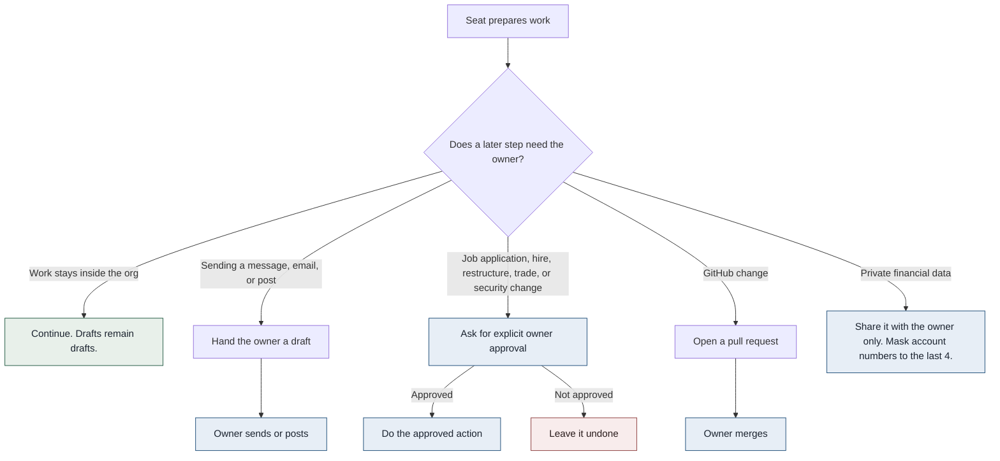
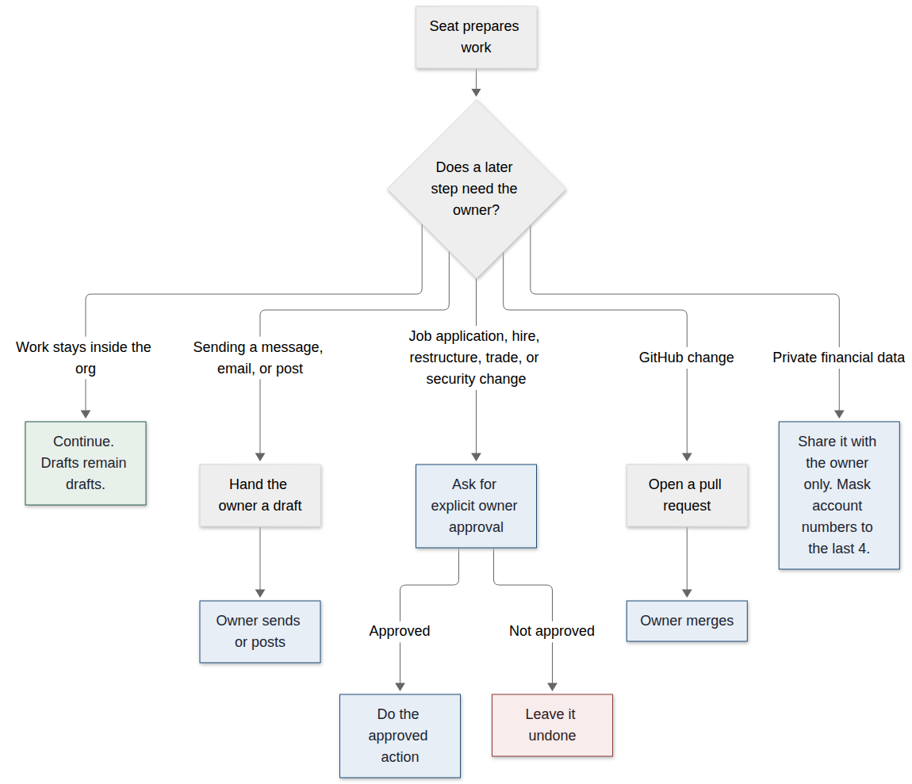

# Approval gates

Agents prepare work. The owner, Tishan Perera, approves anything that leaves the org, moves money, hires, or changes security. Amanda, Chief of Staff & COO, runs people ops up to the hire and restructure line.

Outbound messages are drafts. The owner sends them.

## Matrix

| Action | Who prepares it | Who approves | If approval is missing |
| --- | --- | --- | --- |
| Send an email | Head of Gmail can draft | Owner sends | The email stays a draft |
| Send a message, including WhatsApp | Head of WhatsApp, or the seat that holds the thread, can draft | Owner sends | The message stays a draft |
| Post in public | The seat can draft | Owner posts | It stays a draft |
| Apply to a job | Career & Networking can prepare materials | Owner | No application is submitted |
| Hire a seat | Amanda runs people ops up to this gate | Owner | The seat stays unfilled |
| Restructure the org | Amanda runs people ops up to this gate | Owner | The chart stays as last authorized |
| Trade or place a brokerage order | The Trading pilot could record a paper-only simulated ledger. That department is closed. | Owner. Live trading needs explicit authorization. | No real brokerage order. The pilot rule prohibited real brokerage orders. |
| Change security | The seat stops and asks | Owner | No security change |
| Change GitHub | Open a pull request | Owner merges | The default branch stays as the owner left it |
| Share private financial data | Keep it with the owner | Owner holds it | It is not copied to other seats or to a public page. Account numbers are masked to the last 4. |
| Polish the dashboard | Design (Lex, Chief Design Engineer) and AI Systems (Rio) can propose the change | A business KPI and a usage check come first | Polish waits |

The last row is a sequencing rule from [ADR 0002](adr/0002-chief-kpis-and-cost-discipline.md). It sits beside the weekly KPI for each chief. It is not a license to skip the other rows.

## Flow

## Where this is recorded

- [ADR 0001: Owner approval gates](adr/0001-owner-approval-gates.md)
- [ADR 0002: Chief KPIs and cost discipline](adr/0002-chief-kpis-and-cost-discipline.md)
- [ADR 0003: Shutting down the Trading pilot](adr/0003-shutting-down-the-trading-pilot.md)

The Trading row is a closed pilot, not an open desk. The shutdown date is 17 November 2026. Results from that pilot are omitted on purpose, and the lesson is in ADR 0003.
