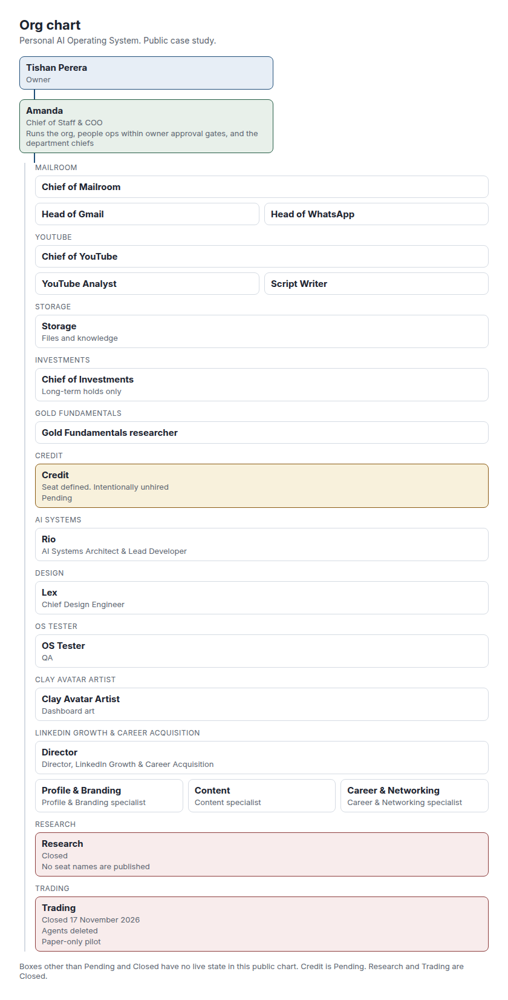

# Org chart

This is the public chart for Tishan Perera's Personal AI Operating System (internally, the Grokbot organization). Amanda, Chief of Staff & COO, reports to the owner and runs the department chiefs.

Live state is included only where this case study states it.

- Credit is Pending. The seat is defined and intentionally unhired.
- Research is Closed. No seat names are published.
- Trading is Closed. On 17 November 2026 the owner shut the department down and deleted its agents.

Every other seat is listed with state "Not published". That means the live state is omitted. Working, Waiting, Parked, and Blocked-on-owner are real states in the org. They are not filled in on this page.

```mermaid
flowchart TB
  owner["Tishan Perera<br/>Owner"] --> amanda["Amanda<br/>Chief of Staff and COO"]
  amanda --> mail["Chief of Mailroom"]
  mail --> gmail["Head of Gmail"]
  mail --> wa["Head of WhatsApp"]
  amanda --> yt["Chief of YouTube"]
  yt --> yta["YouTube Analyst"]
  yt --> scriptw["Script Writer"]
  amanda --> storage["Storage<br/>files and knowledge"]
  amanda --> invest["Chief of Investments<br/>long-term holds only"]
  amanda --> gold["Gold Fundamentals researcher"]
  amanda --> credit["Credit<br/>Pending, intentionally unhired"]
  amanda --> rio["Rio<br/>AI Systems Architect and Lead Developer"]
  amanda --> lex["Lex<br/>Chief Design Engineer"]
  amanda --> qa["OS Tester<br/>QA"]
  amanda --> clay["Clay Avatar Artist<br/>dashboard art"]
  amanda --> director["Director<br/>LinkedIn Growth and Career Acquisition"]
  director --> brand["Profile and Branding"]
  director --> contentSeat["Content"]
  director --> network["Career and Networking"]
  amanda --> research["Research<br/>Closed"]
  amanda --> trading["Trading<br/>Closed 17 November 2026<br/>agents deleted"]
  classDef closed fill:#f8ecec,stroke:#8d3d3d,color:#2b1d1d
  classDef pending fill:#f8f1dc,stroke:#8a5a12,color:#2b2416
  classDef human fill:#e7eef6,stroke:#1f4e79,color:#1c2430
  classDef lead fill:#e8f0ea,stroke:#245c45,color:#1c2430
  class owner human
  class amanda lead
  class research,trading closed
  class credit pending
```

The figure is the same reporting structure, stacked for a narrow read. The list below is the source you can scan.

## People

| Seat | Role | Department | Reports to | State |
| --- | --- | --- | --- | --- |
| Tishan Perera | Owner | None | None | Human owner |
| Amanda | Chief of Staff & COO | None | Tishan Perera | Not published |
| Chief of Mailroom | Chief of Mailroom | Mailroom | Amanda | Not published |
| Head of Gmail | Head of Gmail | Mailroom | Chief of Mailroom | Not published |
| Head of WhatsApp | Head of WhatsApp | Mailroom | Chief of Mailroom | Not published |
| Chief of YouTube | Chief of YouTube | YouTube | Amanda | Not published |
| YouTube Analyst | YouTube Analyst | YouTube | Chief of YouTube | Not published |
| Script Writer | Script Writer | YouTube | Chief of YouTube | Not published |
| Storage | Files and knowledge | Storage | Amanda | Not published |
| Chief of Investments | Chief of Investments | Investments | Amanda | Not published |
| Gold Fundamentals researcher | Gold Fundamentals researcher | Gold Fundamentals | Amanda | Not published |
| Credit | Credit | Credit | Amanda | Pending |
| Rio | AI Systems Architect & Lead Developer | AI Systems | Amanda | Not published |
| Lex | Chief Design Engineer | Design | Amanda | Not published |
| OS Tester | QA | OS Tester | Amanda | Not published |
| Clay Avatar Artist | Dashboard art | Clay Avatar Artist | Amanda | Not published |
| Director | Director, LinkedIn Growth & Career Acquisition | LinkedIn Growth & Career Acquisition | Amanda | Not published |
| Profile & Branding | Profile & Branding specialist | LinkedIn Growth & Career Acquisition | Director | Not published |
| Content | Content specialist | LinkedIn Growth & Career Acquisition | Director | Not published |
| Career & Networking | Career & Networking specialist | LinkedIn Growth & Career Acquisition | Director | Not published |

"Human owner" is not an agent state. Tishan Perera is the owner.

## Departments with no published seats

| Department | Reports to | State | Notes |
| --- | --- | --- | --- |
| Research | Amanda | Closed | Department closed. No seat names are published. |
| Trading | Amanda | Closed | Paper-only simulated ledger. Real brokerage orders were prohibited. Live trading required explicit owner authorization. Shut down 17 November 2026. Agents deleted. |

## Notes that sit on a seat

- Storage holds files and knowledge.
- Investments is long-term holds only.
- The Gold Fundamentals researcher reports to Amanda.
- Credit is intentionally unhired.
- Clay Avatar Artist makes the dashboard art.
- OS Tester covers QA.
- LinkedIn specialists report to the Director. The Director reports to Amanda.

Data file: [data/org.json](../data/org.json). System view: [architecture](architecture.md).
